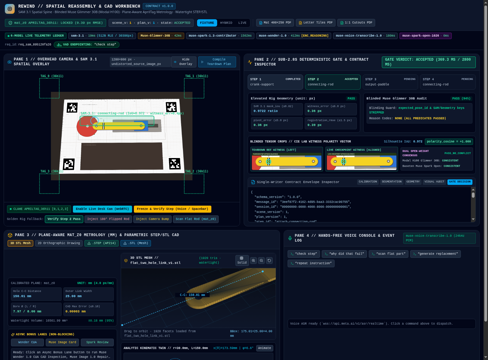
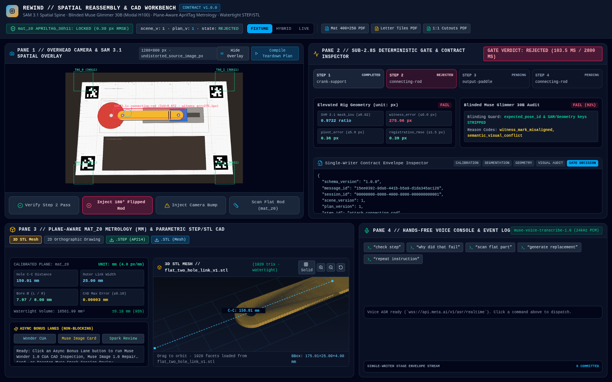
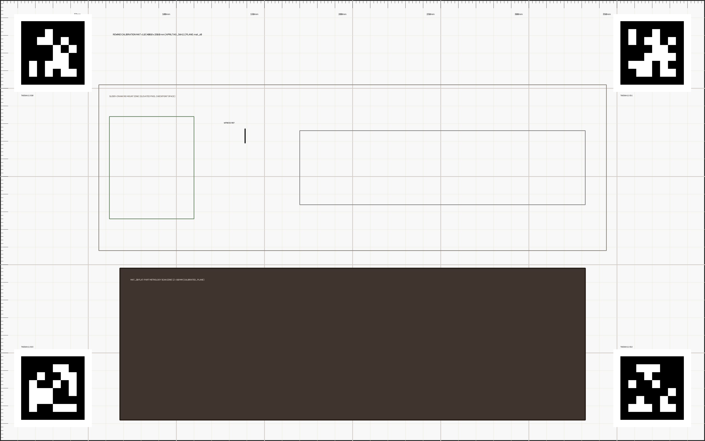
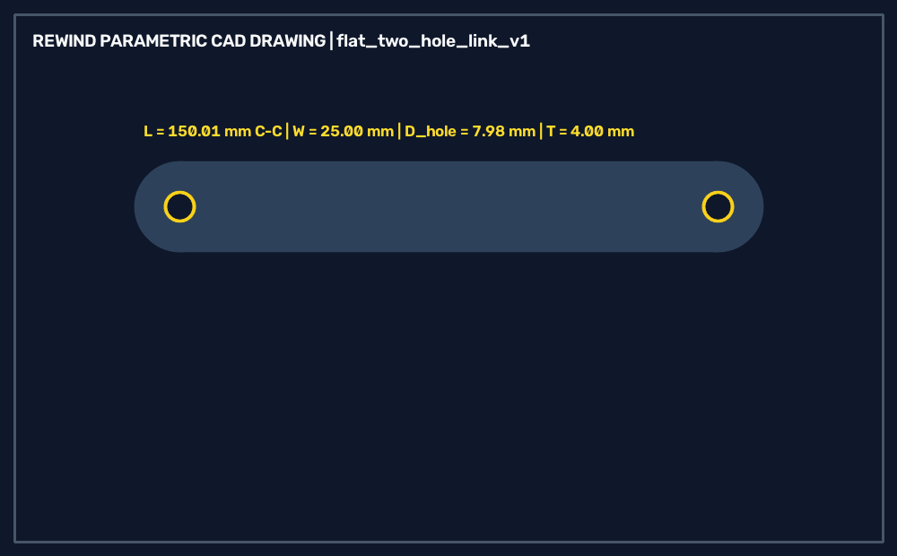

# REWIND — Plane-Aware 2.5D Physical Teardown, Sub-2.8s Reassembly Verification & Parametric CAD Link Regeneration on the Meta Model Stack

> **Watch a mechanism come apart. REWIND checks the rebuild in under 2.8 seconds and recreates a missing flat mechanical link (`flat_two_hole_link_v1`) as a watertight `.STL` plus a faceted, mesh-derived `.STEP` from mat-plane millimeter estimates.**

> **Honesty note (external audit 2026-10-29):** camera calibration is currently **unvalidated** (placeholder intrinsics/distortion, no holdout set), so no fabrication tolerance (e.g. ±0.25 mm) is established. Mat-plane measurements are only valid for parts lying flush on `z = 0`; raised features are subject to parallax (see `backend/app/projection.py`). The `.STEP` is a FACETED_BREP derived from the mesh, not an analytic CadQuery solid. See `docs/audits/2026-10-29-external/RESPONSE.md`.

Built for the **Meta Global AI Developer Hackathon (2026)** across the **Indie Track** plus the **Open Weight ($10K)**, **Agentic ($5K)**, and **Creative ($5K)** bonus tracks.

---

## 1. Live 4-Pane Industrial Operator Workbench

### Verified Checkpoint Pass & Interactive 3D `.STL` / `.STEP` Replacement Link


### Deterministic Rejection of a 180° Flipped Connecting Rod (High Silhouette Overlap, Failed Witness & Blinded Visual Audit)


---

## 2. Why REWIND Exists

When technicians, robotics engineers, or field operators disassemble a mechanical linkage without service drawings, two failure modes dominate:
1. **Silent Reassembly Errors**: A symmetric-looking link (`connecting_rod`) is reinstalled **180° flipped** or only partially seated on its shoulder pin. Pure bounding-box or mask-IoU checks pass (`IoU = 0.9722`), causing mechanism binding or jam under load.
2. **Broken or Missing Flat Links**: A flat connecting rod is cracked or missing. Uncalibrated monocular depth guesses cannot support fabrication tolerances.

**REWIND** solves both problems through a **strict single-writer contract (`CONTRACT.md`)**, **plane-aware 2.5D metrology**, and a **multi-model Meta AI + Open-Weight Muse architecture**:
- **Elevated Assembly Checks (`unit: "px"`, `camera_undistorted_px`)**: Never hallucinate millimeters on elevated links (`z > 0`) due to perspective parallax. Elevated checkpoints evaluate `sam-3.1` full-frame segmentation masks (`mask_iou >= 0.82`), directional witness stripe alignment (`witness_error_px <= 6.0 px`), and pivot seating (`pivot_error_px <= 4.0 px`) in parallel with a **blinded `Muse Glimmer 30B` visual audit** inside a **2.8-second hard gate**.
- **Calibrated `mat_z0` Flat-Link Metrology (`unit: "mm"`, `plane_id: "mat_z0"`)**: When a flat link is placed flush on the `400 × 250 mm` `APRILTAG_36h11` calibration mat (`z = 0`), REWIND rectifies the contour via the planar homography $H_{\text{undistorted\_px}\to\text{mat\_z0\_mm}}$, extracts `hole_center_distance = 150.01 mm`, `outer_width = 25.00 mm`, and bore diameters (`7.97 / 8.00 mm`), and drives a deterministic trimesh CAD worker (`flat_two_hole_link_v1`) to export a watertight **`.STL`**, a **faceted mesh-derived ISO-10303-21 `.STEP`** (topology-checked: closed shell, every face on its PLANE, face count = triangle count), and **2D orthographic drawings**. The `0.00003 mm` figure is model-vs-intended-dimension self-consistency, *not* measurement accuracy; the calibration is unvalidated.

---

## 3. Meta Model API & Open-Weight Muse Architecture

Every runtime stage has a single authorized producer under `contracts/contract.schema.json` (JSON Schema Draft 2020-12):

| Stage / Role | Model & Endpoint | Authorized Producer | Latency (Measured / Target) | Role in REWIND |
| :--- | :--- | :--- | :--- | :--- |
| **Spatial Segmentation & Video Tracking** | **`sam-3.1`** (`POST https://api.meta.ai/v1/responses`) | `sam_adapter` | **`816–1,089 ms`** (live measured, up to 3 parts in 1 call) | Tracks 7 mechanism modules across teardown clips and segments stationary checkpoint frames via custom base85 range-coded mask decoding (`<0f>0<\|box...\|><\|mask;...\|>`). |
| **Blinded Visual Auditor (Open Weights)** | **`Muse Glimmer 30B`** on Modal H100 (`modal_app/glimmer_server.py`) | `glimmer_adapter` | **`~1.1–1.8 s`** warm container snapshot | Inspects reference vs. live frames with **strict input blinding** (never sees planner claims or geometry pass/fail labels) to catch flipped witness marks, proud pins, or washers. |
| **Fast State Compiler & Failure Recovery** | **`muse-spark-1.3-contributor`** (`POST https://api.meta.ai/v1/responses`) | `wonder_adapter` | **`1,501 ms`** (`reasoning.effort="minimal"`) | Compiles the reverse reassembly DAG from teardown observations and generates source-grounded recovery instructions under `wonder-output.schema.json`. |
| **High-Depth Planner & Native Computer Use (CUA)** | **`muse-wonder-1.0`** (`POST https://api.meta.ai/v1/responses`, `tools: [{"type": "computer"}]`) | `wonder_adapter` | Async inspection lane | Final-run reverse state compiler and sandboxed CUA inspector (`computer_call` -> screenshot verification of exported `.STEP`/`.STL` orthographic projections). |
| **Hands-Free Voice Control** | **`muse-voice-transcribe-1.0`** (`wss://api.meta.ai/v1/asr/realtime`) | `voice_relay` | **`989 ms`** handshake / **`1,626 ms`** E2E | Streams 24 kHz 16-bit mono PCM audio in `ENDPOINTING` mode and triggers deterministic operator commands (`check_step`, `why_did_that_fail`, `scan_flat_part`, `generate_replacement`, `repeat_instruction`) only on final `speechComplete`. |
| **Visual Repair Cards** | **`muse-image-1.0`** (`POST https://api.meta.ai/v1/images/edits`) | `image_adapter` | **`6,648 ms`** (async explanatory lane) | Generates annotated visual repair cards highlighting orientation arrows and seating targets when a checkpoint is rejected. |
| **Ambiguous Session Reviewer (Open Weights)** | **`meta-models/muse-spark-open`** on Baseten (`/v1/chat/completions`) | `spark_open_reviewer` | Async audit lane | Performs multi-step session telemetry triage when repeated operator rejections occur. |

---

---

## 3A. What Is Live vs. Deterministic (Credibility & Telemetry Policy)

REWIND never fabricates token counts, request IDs, or model latencies. Every receipt in `/api/telemetry` carries `measured: true | false`; anything not invoked on the current run is reported as `NOT_MEASURED` with `0` tokens and `0.0 ms` latency.

| Component | What Runs in `mode="live"` | What Runs in `mode="fixture"` (Offline / CI) | Classification |
| :--- | :--- | :--- | :--- |
| **`APRILTAG_36h11` Homography & `mat_z0` Metrology** | OpenCV ArUco + CLAHE + planar homography (`4.0 px/mm`) | Same deterministic code | **Deterministic OpenCV (not a model)** |
| **CIE LAB Witness-Polarity Pre-Check** | `_extract_witness_centroid_lab()` cosine (measured value; `null` + `insufficient_evidence` when the stripe is not measurable; no canned constants) | Same deterministic code | **Deterministic OpenCV pre-check (`DETERMINISTIC_LOCAL`, never presented as a model)** |
| **Parametric `.STEP` / `.STL` CAD Worker** | trimesh mesh + faceted mesh-derived STEP with topology verifier (`flat_two_hole_link_v1`) | Same deterministic code | **Deterministic CAD geometry (faceted, not analytic B-rep)** |
| **Camera calibration** | Placeholder K/distortion, envelope status `unvalidated` | Same | **Unvalidated — no tolerance claim** |
| **Segmentation (`sam-3.1`)** | Live `POST https://api.meta.ai/v1/responses` + base85 RLE decode (`~816–1089 ms` measured in Phase 1) | Local HSV/contour mask fixture (`NOT_MEASURED`) | **Live Meta Model API** |
| **Blinded Visual Witness/Seating Audit** | `BasetenVisionAuditor` -> live Baseten `meta-models/muse-spark-open-1026` (`image_url` base64, `max_tokens=2048`, `<think>` stripped, real `usage` tokens recorded), with automatic fallback to Meta `muse-spark-1.3-contributor` vision if multimodal input is rejected | `modal_app/glimmer_server.py` OpenCV/LAB heuristic (`usage: null`, labeled `NOT_MEASURED`); fails closed (unknown) on missing/blank/undecodable images. Real Glimmer 30B inference is **not** deployed | **Live Baseten / Meta Vision in `live`; deterministic heuristic in `fixture` (Modal H100 vLLM deploy blocked only by workspace billing card gate)** |
| **Two-Stage Checkpoint Gate** | Stage 1 (≤2.8 s, measured 1,070–2,339 ms with retries): live `sam-3.1` + IoU/LAB-witness gives a **provisional** verdict only. Stage 2 (async, ≤20 s): live Baseten `muse-spark-open-1026` vision audit on paired blinded crops (measured 4.8–6.6 s, 475 prompt tokens, `max_tokens=1536`); `sam-3.1` has bounded retry (≤2, ≤1.6 s) confirms or overrides it, pushed as WS `checkpoint_stage2` | Stage 2 makes no model call and stays `unknown` (never auto-accepts) | **Fail closed: accept only when both stages agree; timeout/unreadable gives unknown; late results after reset or camera motion are discarded** |
| **Open-Weight Conflict Arbiter** | Live Baseten `meta-models/muse-spark-open-1026` (`POST https://inference.baseten.co/v1/chat/completions`, measured `3,610 ms`, `prompt_tokens=287`, `completion_tokens=800`, req `54ca701a184499b9f75bfa559080e6c99749e`) | Deterministic rule when `IoU >= 0.90` & witness fails (`NOT_MEASURED`) | **Live Baseten Open-Weight (`BASETEN_OPEN_WEIGHT`)** |
| **Reverse DAG & Planner (`muse-spark-1.3-contributor`)** | Live `POST https://api.meta.ai/v1/responses` (`1,501 ms`, `input_tokens=380`, `output_tokens=549`) | Cached schema-valid fixture (`NOT_MEASURED`) | **Live Meta Model API** |
| **CAD Drawing CUA (`muse-wonder-1.0`)** | `MetaWonderClient.run_cua_step()` sends `tools: [{"type": "computer"}]` to Meta `/v1/responses` when `mode="live"` | Deterministic UI cursor overlay labeled `measured: false` | **Live request payload only; status `cua_actions_returned`/`no_cua_actions`, `measured: false` — actions are not executed or verified** |
| **Voice Command (`muse-voice-transcribe-1.0`)** | Live `wss://api.meta.ai/v1/asr/realtime` (`1,626 ms` E2E on `check_step_24khz.wav`) | Browser Web Speech / button trigger (`NOT_MEASURED`) | **Live Meta Realtime ASR; negated commands rejected; voice `check_step` never fabricates a pass without a live frame** |
| **Visual Repair Card (`muse-image-1.0`)** | Live `POST https://api.meta.ai/v1/images/edits` (`6,648 ms`) | Pre-rendered `repair_card_step2.png` (`NOT_MEASURED`) | **Live Meta Image Edit API** |

---

## 4. Plane-Aware Metrology & Printable Hardware Artifacts

### 1:1 Printable `400 × 250 mm` `APRILTAG_36h11` Calibration Mat (`plane_id: "mat_z0"`)


- **Printable PDFs included in `fixtures/printable/`**:
  - `rewind_apriltag_mat_400x250mm.pdf`: Full-bleed `400 × 250 mm` calibration mat with 4 corner `APRILTAG_36h11` fiducials (IDs `0, 1, 2, 3`, 16 outer corner coordinates) and a `300 × 150 mm` central workspace.
  - `rewind_apriltag_mat_letter_tiles.pdf`: 2-page US Letter tiled version with precision splice crosshairs at `X = 200.0 mm`.
  - `rewind_slider_crank_cutouts_1to1.pdf`: 1:1 printable cutout & drilling templates for the 7-module slider-crank test rig (`crank_disk` $R=30\text{ mm}$, `connecting_rod` $L=150.0\text{ mm}, W=25.0\text{ mm}$, `slider_block` $60\times 40\text{ mm}$).

### Parametric `.STEP` / `.STL` CAD Regeneration & Orthographic Drawing (`flat_two_hole_link_v1`)


When the removed connecting rod is placed flat on `mat_z0`, REWIND computes the homography $H_{\text{img}\to\text{mat}}$ (`4.0 px/mm`), extracts the outer capsule contour and inner bores, combines them with operator-supplied thickness (`4.00 mm`), pin diameter (`6.35 mm`), and clearance (`0.25 mm`), and generates:
- `fixtures/cad_outputs/flat_two_hole_link_v1.step` (ISO-10303-21 faceted, mesh-derived FACETED_BREP)
- `fixtures/cad_outputs/flat_two_hole_link_v1.stl` (watertight triangle mesh, verified volume `16,561.99 mm³`)
- `fixtures/cad_outputs/flat_two_hole_link_v1_drawing.svg` & `.png` (dimensioned 2D engineering drawing)

---

## 5. Sub-2.8s Deterministic Gate & Semantic Invariants

REWIND enforces 10 runtime semantic invariants (`backend/app/semantic_validator.py` & `backend/app/gate.py`) beyond JSON Schema validation:
1. **Single-Writer Stage Ownership**: `sam_adapter`, `geometry_service`, `glimmer_adapter`, `wonder_adapter`, `gate_service`, `coordinator`, and `cad_worker` can only emit their designated stage payloads. Neither `wonder_adapter` nor `glimmer_adapter` can set `gate_decision.accepted`.
2. **Coordinate Hygiene (`px` vs. `mm`)**: Elevated assembly predicates (`z > 0`) must use `unit: "px"` with `plane_id: null`. Millimeter metrics (`unit: "mm"`) are rejected unless `plane_id == "mat_z0"` and `registration_rmse_px <= 1.5 px`.
3. **Blinded Visual Audit (`sanitize_blinded_glimmer_context`)**: Before calling `Muse Glimmer 30B`, the adapter strips all planner verdicts, geometry pass/fail flags, and IoU numbers so the visual audit cannot rubber-stamp a prior hypothesis.
4. **Atomic Compare-and-Set (CAS) State Machine**: Every checkpoint locks `(scene_version, plan_version, step_id, observation_id)`. If a camera shift (`registration_rmse_px > 1.5 px`) or new movement occurs mid-check, `scene_version` increments and stale in-flight provider responses are quarantined as diagnostic records.
5. **Hard 2.80s Gate Deadline**: If parallel `sam-3.1` segmentation + `Muse Glimmer 30B` visual audit do not complete within `2,800 ms`, the gate transitions deterministically to `UNKNOWN_TIMEOUT` (`accepted = False`).

---

## 6. Repository Structure

```text
rewind/
├── LOCK-IN.md                         # Final architecture scope lock & hardware specification
├── CONTRACT.md                        # Single-writer stage authority & 10 semantic runtime rules
├── API-CONTRACTS.md                   # Verified Meta Model API, Modal, and Baseten wire contracts
├── contracts/                         # JSON Schema Draft 2020-12 envelopes & compact model schemas
│   ├── contract.schema.json
│   ├── wonder-output.schema.json
│   ├── glimmer-output.schema.json
│   └── example-cycle.json
├── api-examples/                      # 9 canonical wire payload examples (SAM 3.1, Wonder, Glimmer, Voice, Image, CUA)
├── backend/app/
│   ├── config.py                      # Environment & provider configuration
│   ├── schemas.py                     # Pydantic v2 models + JSON Schema validator
│   ├── semantic_validator.py          # 10 runtime semantic invariants & Glimmer input blinding
│   ├── calibration.py                 # AprilTag 36h11 corner detector, homography & px/mm converter
│   ├── geometry.py                    # Mask IoU, witness stripe vector error, & mat_z0 link scanner
│   ├── cad_worker.py                  # Parametric flat_two_hole_link_v1 STEP/STL/SVG CAD generator
│   ├── gate.py                        # Sub-2.8s parallel checkpoint gate & failure code classifier
│   ├── state_machine.py               # Atomic CAS state machine (MOVING -> CAPTURING -> CHECKING -> ACCEPTED/REJECTED/UNKNOWN)
│   ├── main.py                        # FastAPI server + WebSocket voice relay + static workbench host
│   └── providers/                     # Live Meta Model API & Open-Weight clients
│       ├── meta_sam.py                # sam-3.1 client + base85 range-coded mask raster decoder
│       ├── meta_wonder.py             # muse-wonder-1.0 / muse-spark-1.3-contributor + CUA CAD inspector
│       ├── modal_glimmer.py           # Blinded Muse Glimmer 30B vision audit client
│       ├── meta_voice.py              # muse-voice-transcribe-1.0 real-time WebSocket client
│       ├── meta_image.py              # muse-image-1.0 annotated visual repair card client
│       └── baseten_spark.py           # meta-models/muse-spark-open session reviewer client
├── modal_app/
│   ├── glimmer_server.py              # Modal H100 vLLM server for Muse Glimmer 30B with memory snapshot
│   └── README.md                      # Modal deployment & warm-up instructions
├── frontend/                          # 4-Pane React 19 + TypeScript + Three.js STL Operator Workbench
├── fixtures/
│   ├── printable/                     # 1:1 printable 400x250mm AprilTag mat PDFs & slider-crank cutouts
│   ├── golden_rig/                    # Synthetic teardown MP4 clip, pass/flipped/bump/flat-scan frames
│   └── cad_outputs/                   # Generated .STEP, .STL, 2D SVG/PNG drawing, and verification report
├── docs/
│   ├── PHASE1_LIVE_SMOKE_REPORT.md    # Live Meta Model API latencies, token grammar & wire traces
│   └── screenshots/                   # Full HD workbench screenshots
└── tests/                             # 95 unit, contract, pipeline, UI, and live Meta API smoke tests
```

---

## 7. Quickstart & Reproducibility

### 1. Environment Setup
```bash
git clone https://github.com/tejaschaudhari131/rewind.git
cd rewind
cp .env.example .env
# Add your META_API_KEY from https://dev.meta.ai to .env
```

### 2. Run the Full 95-Test Suite (Offline + Live Meta API Smoke Tests)
```bash
pytest -v
```
- Runs contract schema checks (`tests/test_contracts.py`), semantic invariant checks (`tests/test_semantic_validator.py`), provider unit checks (`tests/test_providers_unit.py`), golden metrology/gate/CAD pipeline checks (`tests/test_phase2_phase3_pipeline.py`), Modal + workbench API checks (`tests/test_phase4_modal_and_ui.py`), and live Meta API smoke tests (`tests/test_live_meta_smoke.py`).

### 3. Build Frontend & Launch the 4-Pane Workbench
```bash
cd frontend
npm install
npm run build
cd ..
uvicorn backend.app.main:app --host 0.0.0.0 --port 8000
```
Then open **`http://127.0.0.1:8000`** in your browser to interact with all four operator panes, inspect the 3D `.STL` and 2D orthographic drawings, and run the pass, flipped-rod rejection, camera-bump invalidation, and `mat_z0` flat-link CAD regeneration scenarios.

### 4. Deploy Open-Weight `Muse Glimmer 30B` on Modal (Optional GPU Acceleration)
```bash
modal deploy modal_app/glimmer_server.py
```

---

## 8. License

Released under the [MIT License](LICENSE).
